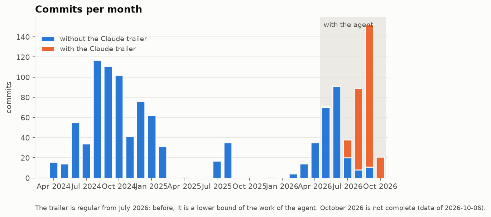
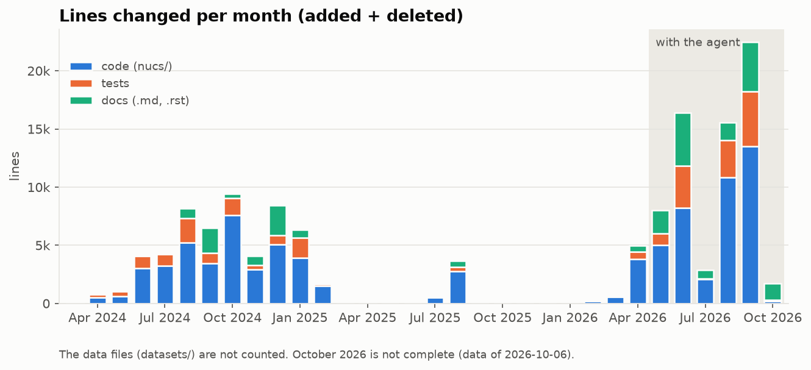
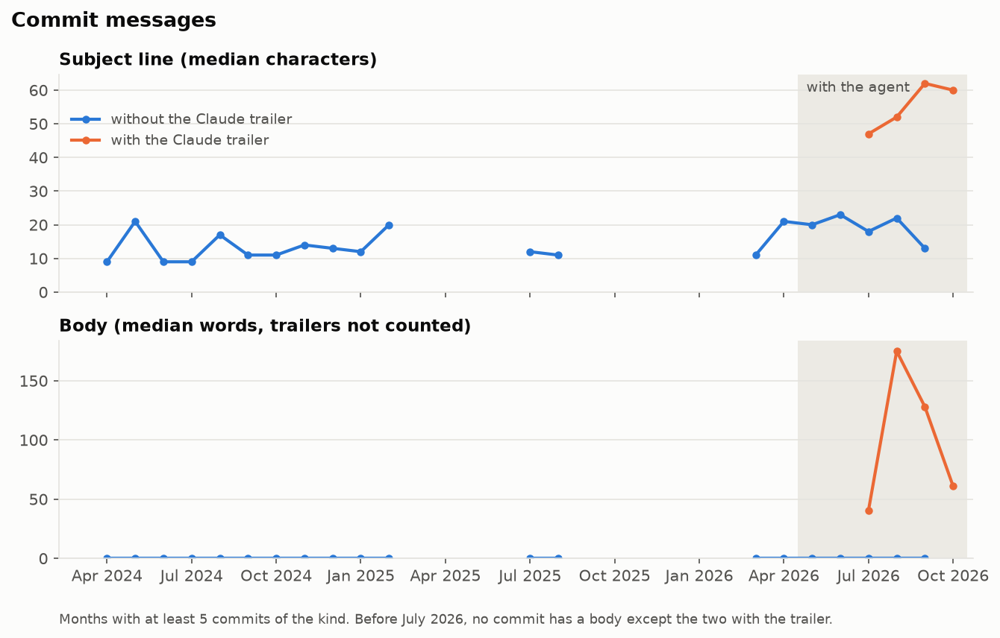
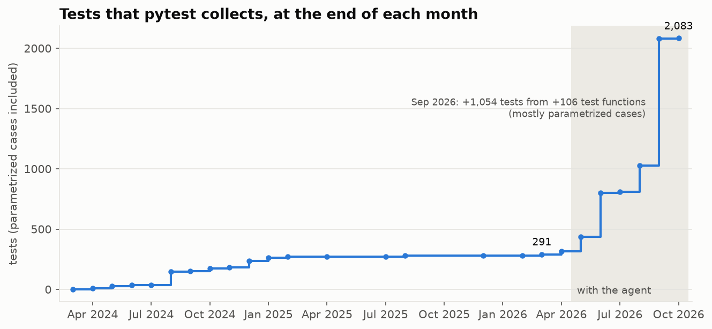
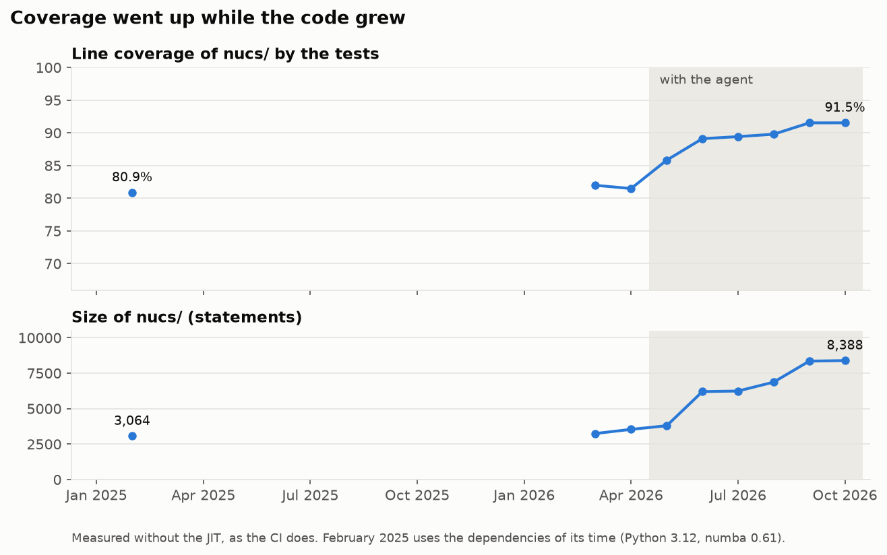
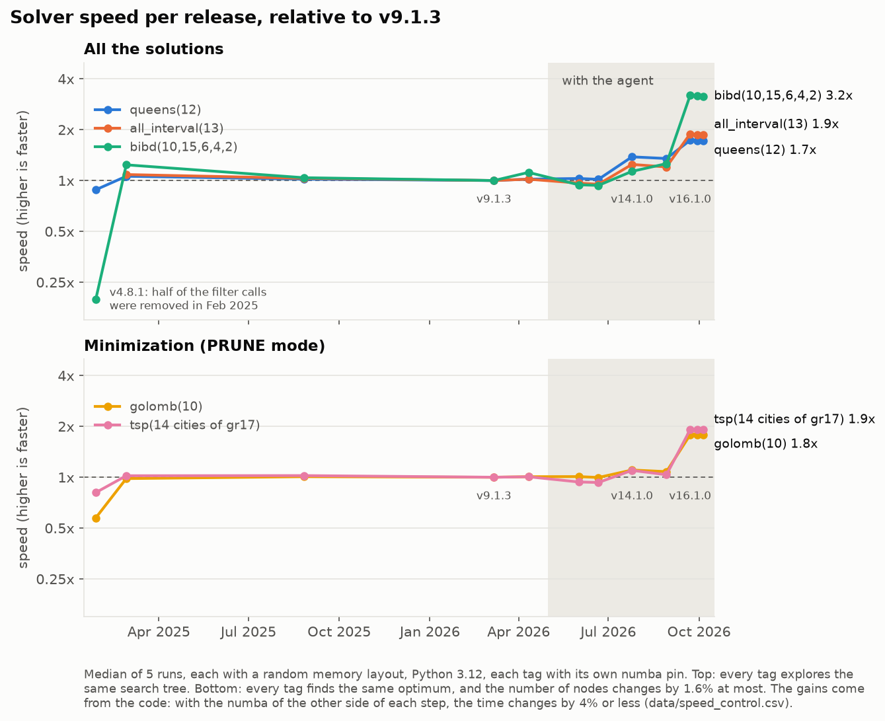

# Developing a constraint solver with an AI agent

*Second version, 2026-10-08. The notes in brackets are for the author.*

Since May 2026, I develop my open-source project with an AI agent: Claude Code, from Anthropic. The agent reads the
code, runs the tests, measures, writes the commits and the documentation, and prepares the releases. I decide, I
review, and I publish.

This article is about programming with an agent. The project is the example: NuCS, a constraint solver in Python. A
constraint solver finds values for variables so that a set of rules (the constraints) is true, for example eight
queens on a chessboard with no two on the same line. You do not need to know more about solvers to read this
article.

All the numbers come from the git history of the project and from measurements that I made for this article.

The short version: **the agent is fast at making claims and slow to doubt them.** The gains are real, but they came
only with a method: measurements with a protocol, tests that compare the code with a slow but correct version, and a
human who decides.

## 1. The project and the period

NuCS is a library of about 8,400 Python statements. Numba compiles the hot part of the code to machine code. Most of
the logic is in **propagators**: small functions that each know one constraint and remove the values that cannot be
part of a solution. NuCS also reads models written in MiniZinc, a standard modeling language for such problems.

A solver is a good test for an agent, for three reasons:

- **The code is small but subtle.** A function that removes one value too many gives a wrong answer that looks
  correct. Nothing crashes.
- **Speed is measurable.** A solver solves well-defined problems, and the time can be compared between versions.
- **The domain is specialized.** To be useful, the agent must read research papers and the source code of other
  solvers.

The history starts with the first commit, in March 2024. The agent started in May 2026. The last version in the
data is NuCS 18.0.0, released on 2026-10-05.

## 2. The way of working

**Skills.** A skill is a short procedure, written in Markdown, that the agent loads when it needs it. NuCS has nine:

| skill                                            | what it does                                                          |
|--------------------------------------------------|-----------------------------------------------------------------------|
| `check-style`                                    | runs the linter and the type checker, and says when they must pass    |
| `run-tests`                                      | runs the tests, with and without the compiler                         |
| `write-tests`, `write-docstring`                 | the conventions for tests and for documentation in the code           |
| `add-header`, `write-numba-friendly-python-code` | the file header, and what compiled code may use                       |
| `add-propagator`                                 | all the steps to add a constraint, from the code to the documentation |
| `bump-version`, `publish-release`                | the rule for version numbers, and the release procedure               |

A skill holds a procedure that I would otherwise explain again in each session. It also holds the lessons of past
errors. For example, the release skill says to put the git tag on the release commit *before* the release exists on
GitHub, because once the GitHub web page put the tag 111 commits too far.

**Architecture documents.** `ARCHITECTURE.md` gives the shape of the code. It is the first file that the agent
reads. A `design/` directory holds the description of the main mechanisms and the proposals. Each proposal starts
with a status line: *proposed*, *implemented*, *closed* or *rejected*, so that a reader knows at once whether it
describes the code. The agent wrote most of these documents: about 2,800 lines.

**Memory.** The agent keeps short notes between sessions: the results of benchmarks, the traps, the decisions, and
the negative results. There are 37 of them. A note records what the repository does not record: why a change was
rejected, or why a measurement was wrong.

**A controlled language.** All the text that the agent writes follows ASD-STE100, the Simplified Technical English of
the aerospace industry: short sentences, one meaning for each word, the active voice. This applies to the answers,
the commits, the changelog, the documentation, and this article. The text is more uniform and easier to read for a
reader whose first language is not English. It is also sometimes longer.

**Where each piece of knowledge goes.** The repository holds what is true about the code. The memory holds the
history and the traps. The skills hold the procedures. When a piece of knowledge is in the wrong place, it gets out
of date: a sentence in a design document that was true in August can be false in October, and the agent believes it.

## 3. Speed of development

The first idea is to count the commits. Chart 1 shows that this is a bad measure.

In 2024, without the agent, there were already months with more than 100 commits. The difference since mid-2026 is
not *how many* commits, but *what* they contain. The trailer `Co-Authored-By: Claude` marks the commits that the agent
writes. It is regular from July 2026: in September, 141 of the 152 commits have it.

The lines that change show more:

| period                                  | code lines changed per month | documentation lines changed per month |
|-----------------------------------------|------------------------------|---------------------------------------|
| Aug 2024 – Jan 2025 (without the agent) | 2,900 – 7,600                | 375 – 2,500                           |
| Aug – Sep 2026 (with the agent)         | 10,800 – 13,500              | 1,500 – 4,200                         |

In the same five months, NuCS got several large features: new search strategies, native versions of several
constraints that MiniZinc models use often, a search state that uses 2 to 80 times less memory, and a faster core
loop (section 6).

**Breaking changes became cheaper.** NuCS 18.0.0 removed ten parameters of the main solver class. The changelog
gives a migration example for each one. Before the agent, I avoided such changes, because the documentation and the
examples took too much time to update.

**What the agent does not make faster:** my decisions, my reviews, and the waits for the continuous integration.

## 4. Quality of the code

**Commit messages.** Before the agent, a commit message was often one or two words:

> `wip` · `clean up` · `fix version` · `refactor (breaking changes)`

With the agent, a commit message says what changed, why, and what was measured:

> **resolve the output terms once, so that fzn-nucs formats a solution 3 to 6 times faster**
>
> FznModel.output_plan resolves each term of the output items to a NuCS variable or a constant at the first print.
> A solution is then one NumPy gather and one join for each array, not one lookup in the symbol table for each
> term. The output does not change.

Chart 2 measures the difference:

| commits                          | median subject line | commits with a body | median body     |
|----------------------------------|---------------------|---------------------|-----------------|
| all months before July 2026      | 9 – 23 characters   | 0% (2 of 594)       | 0 words         |
| with the trailer, Aug – Sep 2026 | 52 – 62 characters  | 91 – 100%           | 128 – 175 words |

The change follows the trailer, not the date. From July to September 2026, the commits without the trailer still
look like the commits of 2024: a short subject and no body. The length also follows the kind of work: an engine
change needs an explanation and a measurement, a fix in the continuous integration does not.

**Tests.** Chart 3 shows the number of tests that the test runner collects at the end of each month.

For a full year, from January 2025 to March 2026, there were about 280 tests. Seven months later, there were 2,083.
A part of this growth is parametrized cases: in September 2026, 1,054 tests came from only 106 new test functions.
Section 5 tells what these cases test. The tests run with the compiler and without it (so that the coverage tool can
see the compiled code), on the oldest and the newest supported Python versions.

**Coverage.** The tests grew faster than the code:

| month         | statements | line coverage | tests |
|---------------|------------|---------------|-------|
| February 2025 | 3,064      | 80.9%         | 271   |
| March 2026    | 3,246      | 82.0%         | 291   |
| October 2026  | 8,388      | 91.5%         | 2,083 |

The coverage stayed at 81–82% for thirteen months without the agent. Then the code grew 2.6 times, and the coverage
went up by 9.5 points. The new code was tested at a higher level than the old code.

**Documentation and style.** The changelog now has migration notes for the major versions, and the docstrings
follow one format. The linter and the type checker run at each commit, through a git
pre-commit hook. The hook only checks and never fixes: git commits the staged files, so a fix made in the hook would
stay out of the commit.

## 5. Correctness: the agent writes the oracles, not only the tests

The most useful tests of this period do not check one example. They compare the code with an **oracle**: a slow
method that is correct by construction.

- **A brute-force probe of all 60 propagators.** For small random inputs, the probe lists every possible assignment,
  keeps the ones that satisfy the constraint, and compares the result with what the propagator keeps. It found a
  wrong answer in propagator `count_eq`, and searches that never stopped in propagators `element_eq` and `gcc`.
- **Differential testing against solver Gecode.** The same MiniZinc model runs in Gecode, a mature solver, and in
  NuCS, and the answers must agree. This found a class of bugs in the MiniZinc adapter: an index that does not
  start at 1 made NuCS answer "no solution" for problems that have one.
- **A bug in optimization.** One propagator, `diffn`, could remove more values when it ran a second time on its own
  output, and the engine skipped that second run. Solutions that broke the constraint came through. The fix made
  this property, idempotence, something that each propagator must declare, and that the engine uses.

Exhaustive testing is cheap now, so I do it for every propagator, not only for the difficult ones.

## 6. Speed of the solver

To measure speed across versions, I solve the same five problems with twelve releases, from January 2025 to October

2026. Three problems ask for all the solutions of a puzzle; two ask for the best solution. Each release runs from its
      own copy of the repository, with its own dependencies.

| problem                          | March 2026, before the agent | October 2026 | speed |
|----------------------------------|------------------------------|--------------|-------|
| queens(12), all solutions        | 1,756 ms                     | 1,025 ms     | 1.7×  |
| all_interval(13), all solutions  | 1,654 ms                     | 883 ms       | 1.9×  |
| bibd(10,15,6,4,2), all solutions | 62.2 ms                      | 19.7 ms      | 3.2×  |
| golomb(10), best solution        | 415 ms                       | 233 ms       | 1.8×  |
| tsp on 14 cities, best solution  | 2,646 ms                     | 1,383 ms     | 1.9×  |

Every release explores the same search (or, for the best solutions, finds the same answer with at most 1.6%
difference in work), so these numbers are the cost of the same work. The dependencies also changed between
releases, so I ran each release with the dependencies of the release on the other side of each step: the time
changed by 4% or less. The gains come from the code.

The speed did not change from February 2025 to June 2026. The gain came in two steps, in July and in September 2026.
To find what made each step, I measured the code after each important commit:

| change                                                                    | queens | all_interval | bibd |
|---------------------------------------------------------------------------|--------|--------------|------|
| **July:** use the work queue better                                       | 0%     | 0%           | +21% |
| **July:** allocate the memory of one hot function once, not at each call  | +42%   | +37%         | 0%   |
| **July:** go back to the library sort in that function                    | −32%   | −28%         | 0%   |
| **July:** use a simple sort below a size limit, the library sort above it | +37%   | +33%         | 0%   |
| **September:** copy the input of each call as plain numbers               | +5%    | +8%          | +28% |
| **September:** give each function its own buffers that live between calls | +15%   | +7%          | −3%  |
| **September:** skip a pass when a call changed nothing                    | +1%    | 0%           | +19% |
| **September:** compile the main loop without reference counting           | +6%    | +30%         | +49% |

Two lessons for programming with an agent are in this table:

- **The history is not a straight line.** A comparison of only the two releases of July shows a clean +39%. The real
  history was +42%, then −32%, then +37%. The first change was fast on small inputs and very slow on large ones,
  the second change fixed the large ones and lost the gain, and the third kept both. Only the points in between show
  it.
- **The same change gives very different gains on different inputs.** The last change gives +6% on one problem and
  +49% on another. The changelog says 1.23–1.36×, measured on other problems. All these numbers are true. A single
  number for a change hides more than it tells.

The search strategies changed too, and they can give much more than the engine. For one example, a new search rule
made a problem 23 to 44 times faster; an engine change gave 3 times on the same problem. Both kinds of gain
came from the same way of working: a hypothesis from the agent, a measurement, and a decision.

On the 16 medium problems of the MiniZinc Challenge 2026, NuCS is now at parity with the established solvers of its
kind, Choco and Gecode. It is behind the solvers that learn from their failures, such as Chuffed and CP-SAT.

## 7. The agent makes hypotheses, the measurement filters them

The agent proposes optimizations quickly, and they all sound right. Most of them do not pay. Some negative results
of the period:

| idea                                                      | result                                                      |
|-----------------------------------------------------------|-------------------------------------------------------------|
| make the hot data structures smaller                      | no gain: they were already in the fastest cache             |
| tell each function which of its inputs changed            | 0.75–0.80×: slower, the bookkeeping cost more than it saved |
| add a second version of many functions for a special case | about no gain in speed (kept for other reasons)             |
| keep more state between calls in two more functions       | rejected after measurement                                  |
| remove the overhead around each function call             | the two parts were worth 2.5% and 1.4%: stopped             |

Three habits made the difference:

- **A prediction before the measurement.** "If the function call dominates, this problem gets faster by more than
  the 9–12% that the whole function is worth." A result is then a test of the hypothesis, not a number to explain.
- **A stop rule set in advance.** "If the two items together are under 10%, stop and write it down." Without it, a
  small result gets a story after the fact, and the work continues.
- **A written protocol**, in `design/benchmarking.md`, made from the measurements that gave wrong numbers:
    - commit before an A/B comparison, and run each side from its own copy of the repository;
    - warm the compiler cache before the timed run;
    - always run a control that the change cannot affect;
    - nothing under 5% is a result, because the order of the runs alone moves the time by 1–4%;
    - compare all the counters of the program, not only the time;
    - change the memory layout of the process at each run. Even the size of the environment variables moves the
      stack, and one release was 1.45 times slower at some sizes, with the same code. Repetitions in the same
      environment repeat the same error.

The agent follows this protocol well once it is written. It did not invent it: each rule came from a wrong number
that one of us saw.

## 8. The role of the human

**The agent does work that I did not ask for.** Sometimes this helps. When I changed the version of MiniZinc in the
continuous integration, the agent saw that the download URL of the new version gave a 404, because the name of the
file had changed. It fixed the URL before the push. Sometimes it is a small scope creep, such as a comment that it
updated in a file that I had changed. The line between the two is not always clear, so I review both kinds.

**The periodic full code review.** From time to time, I stop the new work and read the full code base.
[Author: why it is necessary, and what a full review finds that the review of each change does not. One or two real
examples.]

**Review is the new limit.** The agent writes more than I can read with care. The documentation, the commit messages
and the tests help, because they tell me what to check and why. But the volume is real, and it is now the slowest
part of the work.

## 9. Conclusion

[Author: what you would do again, and what you would do differently. A draft from the data, to change or delete:]

- **Measure everything that the agent claims**, with a protocol, a control and a stop rule.
- **Use oracles, not only examples**, to test the code that the agent writes.
- **Write the lessons down where the agent reads them:** skills for the procedures, design documents with a status
  for the code, memory notes for the traps.
- **Count what changed, not how much.** The commit count did not change; the content of the commits did.

## The data

The data and the scripts are in this directory:

- `collect_data.py` collects the data from the git history: commits, lines changed, commit messages, tests,
  coverage, and the solve times of each release.
- `speed_driver.py` solves one problem with the code of one release.
- `make_charts.py` makes the charts from `data/*.csv`.
- `data/speed_control.csv` holds the dependency control, and `data/speed_attribution*.csv` the commits inside each
  step.
